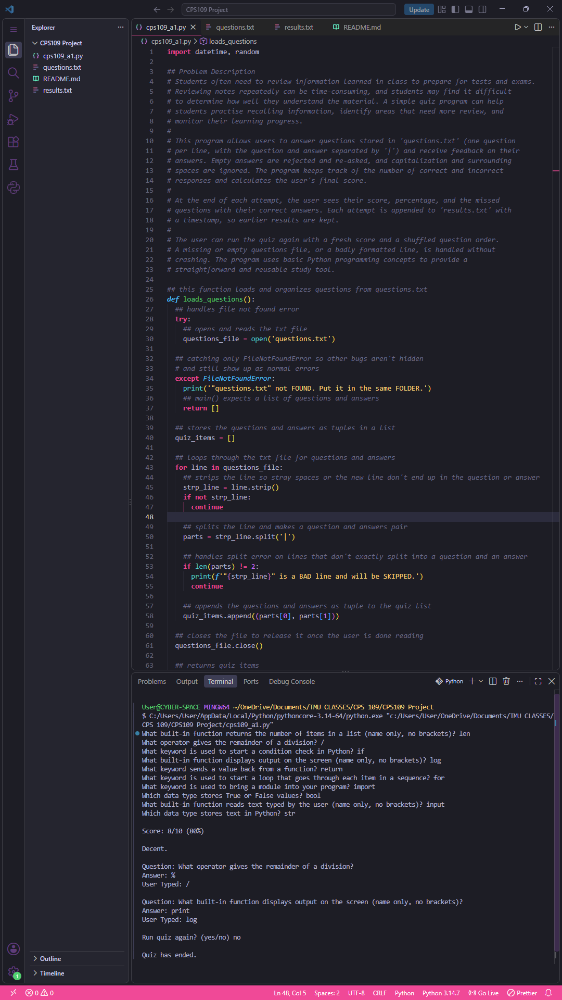
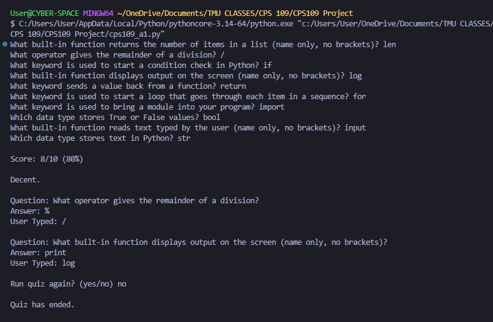

# CPS 109 Python Study Quiz

A command-line Python quiz program built as my first-year project for **CPS 109** at Toronto Metropolitan University (TMU). The project asked us to define our own problem and solve it using core Python constructs: conditions, sequences, loops, functions, imports, and file input and output.

## Overview

The program helps students practise course material using questions stored in a text file. It checks answers, calculates scores, shows feedback after each attempt, and saves results for later review.

## Problem Description

Students often need to review information learned in class to prepare for tests and exams. Reviewing notes repeatedly can be time-consuming, and students may find it difficult to determine how well they understand the material. A simple quiz program can help students practise recalling information, identify areas that need more review, and monitor their learning progress.

This program allows users to answer questions stored in a text file and receive feedback on their answers. It tracks correct responses, calculates the final score, and saves results to an output file. Users can repeat the quiz to continue practising.

## Features

- Loads questions from `questions.txt` and stores each question with its answer as a pair
- Shuffles the question order each round
- Rejects empty answers and asks again
- Accepts answers regardless of capitalization or surrounding spaces
- Shows the score, percentage, and a feedback message after all questions are answered
- Lists each missed question with the user's answer and the correct answer
- Appends each attempt to `results.txt` with a timestamp, so earlier results are kept
- Asks whether to play again, and each round starts with a fresh score
- Handles a missing or empty questions file and badly formatted lines without crashing

## How to Run

1. Install Python 3.
2. Keep `cps109_a1.py` and `questions.txt` in the same folder.
3. From that folder, run:

`python cps109_a1.py`

## Screenshots

**Full IDE view (code and terminal output):**



**Terminal output only:**



## Project Structure

`cps109-python-study-quiz/`
`├── cps109_a1.py`
`├── questions.txt`
`├── results.txt`
`├── README.md`
`└── screenshots/`
`    ├── cps109_a1_output.png`
`    └── terminal_output.png`

- `cps109_a1.py` — Main Python program
- `questions.txt` — Quiz questions and their correct answers
- `results.txt` — Results from completed attempts
- `README.md` — Project documentation
- `screenshots/` — Example runs of the program

## Question File Format

Each line contains one question and its answer, separated by `|`. Blank lines are ignored, and lines that don't split into exactly one question and one answer are skipped with a warning.

```
What keyword is used to define a function in Python?|def
Which data type stores a sequence of items in Python?|list
What symbol is used for comments in Python?|#
```

## Python Concepts Used

Variables and arithmetic, `if`/`elif`/`else`, strings, lists and tuples, `for` and `while` loops, user-defined functions, the `datetime` and `random` modules, file input and output, and `try`/`except` error handling.

## Notes

This is a course project for learning purposes. I wrote the code myself.
